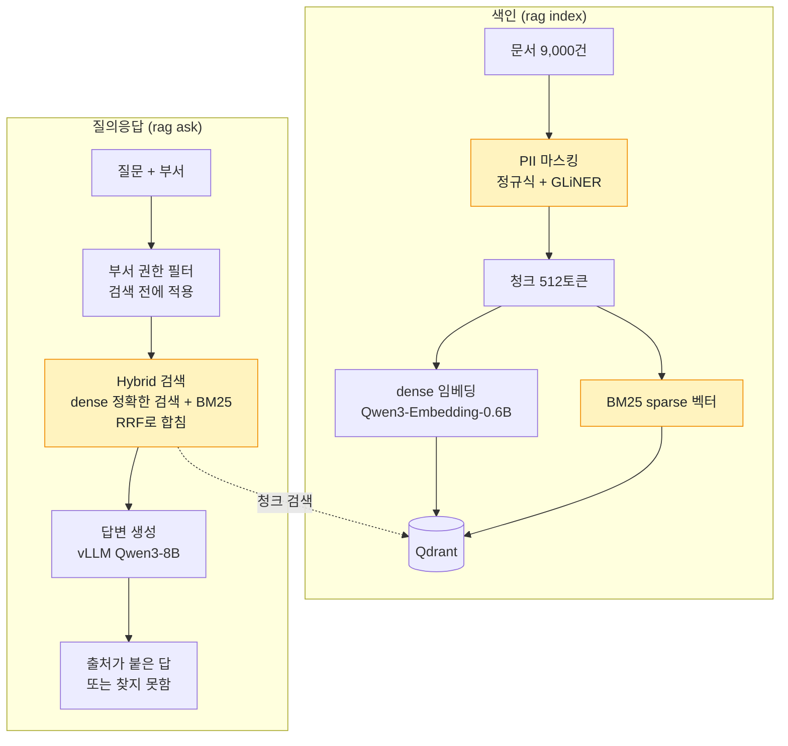

# 권한과 개인정보를 고려한 사내 문서 RAG

직원이 **자기 부서에 허용된 문서 안에서만** 검색하고, **개인정보가 가려진** 근거로 **출처가 붙은 답**을 받는 사내 문서 RAG PoC임.

- **데이터**: UCSF Industry Documents Library(IDL)에 공개된 JUUL Labs 내부 문서(메일, 보고서, 발표 자료)에서 9,000건을 뽑아 고객사 사내 문서로 상정함. 실명과 이메일 주소가 그대로 들어 있어 개인정보 문제를 실제처럼 다룰 수 있음.
- **부서 권한**: 원본에 부서 정보가 없어, IDL이 문서에 붙인 업무 분야 꼬리표를 부서 3개(`marketing`, `regulatory`, `product`)에 연결해 문서마다 볼 수 있는 부서를 정함 ([ADR-0001](docs/adr/0001-department-from-idl-topic.md)).

처음 구조를 dense 검색 + spaCy 마스킹에서 시작하여 아래의 아키텍처로 고도화함.

| 구성 | 처음 | 지금 |
|---|---|---|
| 개인정보 마스킹 | spaCy 이름 인식 + 정규식(이메일, 전화번호) | GLiNER 이름 인식 + 정규식, 보정 규칙 보완 |
| 검색 | dense 근사 검색(HNSW) | dense 정확한 최근접 검색 + BM25, 순위로 합침(RRF) |

| 지표 | 처음 | 지금 |
|---|---|---|
| 검색 누출률 (권한 밖 청크가 검색된 비율) | 0.00 | **0.00** |
| 검색 Recall@5 | 0.60 | **0.85** |
| PII Recall | 0.73 | **0.92** |
| PII Precision | 0.75 | **0.88** |

Recall@5의 처음 값은 검색을 고치기 전(dense 근사 검색)에 잰 값임.

## 1. 문제 정의

**상황 (가정)**
- 문서는 직원 메일함, 부서별 공유 드라이브, 부서별 문서 저장소에 흩어져 있고, 시스템마다 부서 단위 열람 권한이 있음.
- 검색 수단은 시스템마다 딸린 키워드 검색뿐이라, 표현이 다르면 찾지 못하고 찾은 문서도 사람이 직접 읽어야 함.

**새 도구가 지켜야 할 조건**
1. 질문자의 부서에 허용되지 않은 문서를 근거로 답변하지 않아야 함.
2. 답변과 색인에 드러나는 개인정보를 최소화함.
3. 문서 데이터가 외부로 나가지 않아야 함.

**풀어야 할 문제**

| 문제 | 내용 | 해결 |
|---|---|---|
| 1. 활용 방식 | 키워드 검색의 한계를 풀면서 세 조건을 지킬 기술이 필요함 | RAG (2.1) |
| 2. 개인정보 | 기본 RAG + spaCy 이름 인식으로 시작하니, 표, 명단, 서명에 홀로 적힌 이름을 놓쳐 PII Recall 0.73 | GLiNER로 교체 (2.2) |
| 3. 검색 정확도 | 의미 검색만 쓰는 기본 RAG의 Recall@5 0.60. 실패의 절반 이상이 고유명과 약어 질문이고, 색인을 다시 만들면 같은 질문의 검색 결과가 바뀜 | 정확한 최근접 검색, Hybrid 검색 (2.3) |

## 2. 해결 과정: 후보와 선택 이유

### 2.1 활용 방식: RAG ([ADR-0003](docs/adr/0003-rag-over-alternatives.md))

| 후보 | 판단 |
|---|---|
| 통합 검색 | 권한 필터는 걸 수 있지만 문서 목록만 주므로 읽고 정리하는 부담이 남음 |
| 지식베이스, 위키 정리 | 품질은 높지만 사람이 정리해야 해 비용이 크고, 문서가 늘 때마다 다시 정리해야 함 |
| LLM 파인튜닝 | 출처를 인용할 수 없고, 모든 문서가 모델 하나에 섞여 부서 권한을 지킬 수 없음 |
| 외부 AI 서비스 | 문서가 회사 밖으로 나가 조건 위반 |
| **RAG (선택)** | 부서가 볼 수 있는 청크만 검색하고, 사내 LLM이 그 청크를 근거로 출처를 붙여 답함. 세 조건을 모두 지킴 |

### 2.2 개인정보: 이름 인식 모델을 GLiNER로 교체 ([원인 분석](docs/design/issue8-followup.md#21-pii-누락-원인-27), [모델 비교 #39](https://github.com/jhlee5647/enterprise-rag-project/issues/39), [GLiNER 조정 #44](https://github.com/jhlee5647/enterprise-rag-project/issues/44))

PII 누락의 원인 후보를 넷으로 세우고 결과를 보며 좁힘.

| 원인 후보 | 확인 방법 | 결과 |
|---|---|---|
| 정답셋 | 사람이 초안 없이 다시 표시 | 정답셋이 빠뜨린 실명 거의 없음, 제외 |
| 지표 계산 | 덜 가린 이름을 세는지 확인 | 일부만 가려도 맞은 것으로 셈, 글자 위치 기준으로 고침 |
| 규칙 빈틈 | 남은 누락을 유형별로 분류 | 작은 몫(저자 표기, 가운데 머리글자), 규칙 보완 |
| **모델 한계** | 같은 이름을 문장에 넣어 다시 실행 | 누락 33개 중 약 20개를 잡음. 문맥 없는 이름에 약한 것이 주원인 |

이름 인식 모델 비교 (개발용 50청크, 이름만, 높을수록 좋음):

| 후보 | 이름 Recall | 이름 Precision | 판단 |
|---|---|---|---|
| spaCy `en_core_web_lg` (기존) | 0.74 | 0.64 | 기준 |
| spaCy `en_core_web_trf` | 0.61 | 0.84 | 오탐은 줄지만 누락이 늘어남 |
| 로컬 LLM (Qwen3-8B) | 0.83 | 0.67 | 누락은 가장 적지만 마스킹 시간 23배 |
| **GLiNER (선택)** | 0.76 | 0.68 | 감당할 수 있는 속도에서 둘 다 기존보다 나음. 레이블을 직접 정할 수 있음 |

- GLiNER는 `Distributor` 같은 역할 명사를 이름으로 봄. 레이블을 `person name`, `job title`, `organization`으로 나누고 한정사(`the`, `each` 등) 바로 뒤 한 단어는 이름에서 빼, 이름 Precision을 0.68 → 0.80으로 올림.
- **결과** (측정용 50청크, 이름, 이메일, 전화번호): 규칙 보완과 GLiNER를 합쳐 PII Recall 0.73 → 0.92, Precision 0.75 → 0.88로 올림.

### 2.3 검색 정확도

#### ① 재현성: 정확한 최근접 검색 ([설계 기록 1, 4절](docs/design/retrieval-improvement.md#1-근사-검색이-상위-5개를-바꾼다))

부서 필터를 건 근사 검색(HNSW)은 색인을 만들 때마다 결과가 달라졌음. 같은 마스킹 결과로 만든 두 색인의 Recall@5가 0.61과 0.60이었고, 상위 5개가 정확한 검색과 다른 실행도 150번 중 31번이었음. 결과가 흔들리면 개선 효과를 비교할 수 없음.

| 후보 | 결과 |
|---|---|
| 권한 필드에 payload 색인 | 필터 검색의 표준 설정이라 먼저 시도. 그래도 33/150번이 달라 해결 안 됨 |
| 탐색 폭(`hnsw_ef`) 늘리기 | Recall@5 0.61로 정확한 검색(0.62)에 못 미침 |
| **정확한 최근접 검색 (선택)** | 색인 구조에 따라 결과가 흔들리지 않고, 정의상 놓치는 청크가 없음. 7만 청크 규모에서 검색 중앙값 119ms → 71ms로 오히려 빨라짐 |

#### ② 고유명, 약어 질문: Hybrid 검색 ([설계 기록 6절](docs/design/retrieval-improvement.md#6-하이브리드-검색))

실패한 실행을 판정해 보니 절반 이상이 고유명, 약어 질문(`REG`, `Sacrificial Concepts`, `Brand Cling` 등)이었음. 의미 검색만으로는 이런 단어를 놓쳐 키워드 검색 보강이 필요했음.

| 후보 | 판단 |
|---|---|
| 리랭커 | 후보 안의 순서만 바꿈. 고유명 실패 9번 중 6번은 정답이 상위 20개에도 없었음 |
| dense + BM25, 점수 가중합 | 가중치를 정할 근거가 없음 |
| **dense + BM25, 순위로 합침 (RRF, 선택)** | 점수 크기를 맞출 필요가 없음 |

- 서버 쪽 RRF는 동점일 때 순서가 정해지지 않아, 같은 질문을 다시 검색하면 144번 중 34번의 상위 5개가 달라졌음. 동점 순서를 고정하는 RRF를 직접 구현해 0/144로 만들었음.
- **대가**: 권한 밖 질문에 답하는 실행도 늘었음. dense 때보다 새로 답한 7번 중 5번이 근거 없는 답이었음 (③).

#### ③ 근거 없는 답: 리랭커는 도입하지 않음 ([설계 기록 3.1절](docs/design/answer-improvement.md#31-결과-63-64))

근거 없는 답은 권한 밖 문서가 새어 나간 것이 아님(검색 누출률 0.00). 질문한 부서가 볼 수 있는 청크 중 단어만 겹치는 것을 늘려 해석한 답임. 이를 줄이려고 리랭커 2종을 비교함.

| | 리랭커 없음 (선택) | Qwen3-Reranker-0.6B | bge-reranker-v2-m3 |
|---|---|---|---|
| Recall@5 | **0.85** | 0.80 | 0.78 |
| 근거 없는 답 (권한 밖 73번 중) | 15 | 22 | **6** |
| 권한 있는 사용자가 맞는 답을 잃은 실행 | **0** | 0 | 7 |
| 검색 중앙값 | **85ms** | 414ms | 620ms |

bge는 근거 없는 답을 크게 줄였지만, 권한 있는 사용자가 맞는 답을 7번 잃고 Recall@5와 검색 속도가 함께 나빠짐. 그래서 리랭커를 켜지 않기로 함.

## 3. 구조



- 색칠한 상자는 처음 구조에서 바뀐 부분임.
- 개인정보는 색인 전에 `[NAME]`, `[EMAIL]`, `[PHONE]`으로 바꾸므로, 검색 결과와 LLM에 원문 개인정보가 들어가지 않음.
- 모든 모델(임베딩, 이름 인식, LLM)은 GPU 서버 한 대(A40) 안에서 로컬로 실행함 ([ADR-0002](docs/adr/0002-local-models-only.md)).
- 권한이 없을 때와 근거가 없을 때 같은 "찾지 못함" 응답을 돌려주므로, 권한 밖 문서가 있다는 사실도 드러나지 않음.

## 4. 정량적 성과

| 지표 | 처음 | 지금 | 뜻 |
|---|---|---|---|
| 검색 누출률 | 0.00 | **0.00** | 권한 밖 청크가 검색된 비율 |
| 검색 Recall@5 | 0.60 | **0.85** | 정답 문서가 상위 5개 청크에 든 비율 (문서 단위, 실행별 평균) |
| PII Recall | 0.73 | **0.92** | 가려야 할 개인정보 중 가린 비율 (글자 위치 기준) |
| PII Precision | 0.75 | **0.88** | 가린 것 중 실제 개인정보인 비율 (글자 위치 기준) |
| 색인 시간 (9,000건) | 96분 | **약 44분** | GLiNER 마스킹 약 25분 포함 |

**Recall@5가 오른 이유 나누기**

| 단계 | Recall@5 |
|---|---|
| 처음 (dense 근사 검색) | 0.60 |
| 정확한 최근접 검색 | 0.62 |
| [평가셋 보완](docs/design/retrieval-improvement.md#5-평가셋-고치기) (같은 문서의 다른 판본도 정답으로 인정, 모호한 질문 제외) | 0.76 |
| **Hybrid 검색** | **0.85** |

평가셋 보완(0.62 → 0.76)을 빼면, 시스템을 바꿔 오른 폭은 0.60 → 0.62와 0.76 → 0.85임.

**평가 조건**
- 평가셋: RAGAS와 로컬 LLM(Qwen3-32B)으로 질문 초안을 만들고 사람이 검수해 남김. 처음 50개(150번 실행), 보완 뒤 48개. 질문마다 부서 3개로 물어 144번 실행 (권한 있는 실행 71번, 권한 밖 실행 73번)
- PII 정답셋: 사람이 검수한 원문 50청크 (이름, 이메일, 전화번호 위치)
- 지연 시간 (현재 기본값, 중앙값 / p95): 검색 85 / 91ms, 답변 생성 1,976 / 8,321ms, 전체 2,100 / 8,455ms

## 5. 한계와 다음 단계

- **근거 없는 답** (권한 밖 질문 73번 중 15번)
  - 예: 마케팅 부서만 볼 수 있는 문서에 Brand Cling 설명이 있음. 규제 부서가 "Brand Cling은 무엇에 쓰나?"를 물으면, 규제 부서가 볼 수 있는 청크에는 매장 부착물 "Customer facing Cling"만 있는데도 LLM이 "Brand Cling은 고객용 마케팅 도구로 문서에 명시돼 있다"고 답함.
  - 다음: 리랭커 점수를 청크를 빼는 데가 아니라 답할지 판단하는 데만 쓰기, 답변 프롬프트 개선
- **날짜를 지정한 질문**
  - 예: "2019년 5월 6일 기준 스페인 J+ 포장 프로젝트 상태는?"의 정답은 Consumables Weekly Dashboard의 한 판인데, 검색 상위 5개에는 같은 대시보드의 1월 7일, 2월 25일, 3월 25일 판이 들어오고 정답 판은 빠짐. "현재 계획"을 묻는 질문도 이전 시점 문서를 가져옴.
  - 다음: 문서 날짜를 메타데이터로 넣고 질문의 날짜로 거르기
- **답변 생성 시간** (전체 지연의 약 94%)
  - 예: 찾지 못함 응답은 0.7초 안에 끝나지만, "영국 Bebop 2단계 출시의 생산 일정 진행 상황은?" 질문은 답변이 5,211자(답한 실행의 중앙값 464자)로 길어져 생성에 26.9초 걸림.
  - 다음: 답변 길이 제한, 간결하게 답하도록 프롬프트 조정

## 6. 실행 방법

**환경**: GPU 서버 한 대 (A40 48GB, 메모리 50GB, RunPod에서 개발), Python 3.12, [uv](https://docs.astral.sh/uv/)

```bash
uv sync

# Qdrant 서버 (127.0.0.1:6333)
scripts/qdrant-server.sh start

# 답변 LLM (OpenAI 호환 API, 127.0.0.1:8000)
uvx --from vllm vllm serve Qwen/Qwen3-8B --host 127.0.0.1 --port 8000 \
  --gpu-memory-utilization 0.6 --max-model-len 16384
```

| 명령 | 하는 일 |
|---|---|
| `uv run rag collect` | IDL에서 표본을 뽑아 본문을 받고, 허용 부서를 계산해 문서 표로 저장 |
| `uv run rag index` | 본문과 제목을 PII 마스킹하고 청크로 잘라 색인 |
| `uv run rag ask --dept marketing "질문"` | 부서를 지정해 질문하고 출처가 붙은 답을 받음 |
| `uv run rag gen-eval` | 평가셋 초안과 PII 정답셋 초안(검수용 CSV)을 만듦 |
| `uv run rag eval --run-name <이름>` | 검수된 평가셋으로 권한, 검색, PII, 지연 지표를 재고 `runs/<이름>/`에 저장 |

- 부서: `marketing`, `regulatory`, `product`
- 경로, 모델, 검색 방식, 리랭커 같은 설정은 모두 [`config.yaml`](config.yaml)에 있음.

**테스트**

```bash
uv run pytest
uv run ruff check
```

## 7. 저장소 구조

```text
src/enterprise_rag/
├── collect.py      # IDL 표본 수집, 허용 부서 계산
├── mask.py         # PII 마스킹 (Presidio 규칙 + GLiNER)
├── index.py        # 청크, 임베딩, Qdrant 색인
├── embedding.py    # dense 임베딩, BM25, 리랭커
├── ask.py          # 권한 필터, Hybrid 검색, 답변 생성
├── gen_eval.py     # 평가셋, PII 정답셋 초안 생성 (RAGAS)
├── evaluate.py     # eval 실행
└── metrics.py      # 지표 계산
docs/
├── adr/            # 결정 기록
└── design/         # 측정과 결정의 근거
GLOSSARY.md         # 용어집
```

## 8. 문서

- [GLOSSARY.md](GLOSSARY.md): 이 프로젝트의 용어
- ADR
  - [0001 부서는 IDL 토픽에서 유도한다](docs/adr/0001-department-from-idl-topic.md)
  - [0002 로컬 모델만 쓴다](docs/adr/0002-local-models-only.md)
  - [0003 RAG를 택한다](docs/adr/0003-rag-over-alternatives.md)
- 설계 기록
  - [PoC 설계 인터뷰](docs/design/poc-design-interview.md)
  - [마스킹 품질, 색인 속도 개선](docs/design/issue8-followup.md)
  - [검색 정확도, 지연 시간 개선](docs/design/retrieval-improvement.md)
  - [근거 없는 답 줄이기](docs/design/answer-improvement.md)
